# 🛡️ Penetration Testing Report (Footprinting & Network Scanning)

**Week 2 — Networkwalks Cybersecurity Internship, Batch B084**


**Author:** Nosiru | **Program:** Networkwalks Cybersecurity Internship, Batch B084 | **Week 2 Project**

---

## 1. Liability Disclaimer

This work was carried out strictly for educational purposes as part of the Networkwalks Cybersecurity Internship. All reconnaissance activity was limited to:

- **networkwalks.com** — a target the Client (Networkwalks) has explicitly authorized for this internship.
- **My own local area network (LAN)** — owned and controlled by me.

A signed [Letter of Authorization](./Letter_of_Authorization_Nosiru_B084.pdf) covering these targets and dates (9–29 November 2026) is included in this repository. No exploitation, brute-forcing, or unauthorized access of any kind was attempted. All activity was passive or non-destructive reconnaissance only.

## 2. Introduction

This report covers the Week 2 project, which focuses on **footprinting** (passive information gathering) and **network scanning**. The goal of this phase of a penetration test is to build a profile of a target using only publicly available information, without ever touching the target's systems directly, and to discover live hosts on a network.

| Field | Detail |
|---|---|
| Pentester | Nosiru |
| Program / Batch | B084 — Networkwalks Cybersecurity Internship |
| Date | November 2026 |
| Modules completed | W2-PM1 (Multiple Kali Tools), W2-PM4 (theHarvester), W2-PM5 (Zenmap) |

## 3. Tools Used

| Tool | Purpose |
|---|---|
| whois | Domain registration lookup |
| whatweb | Web technology fingerprinting |
| nslookup | DNS resolution |
| curl | HTTP header inspection |
| wafw00f | Web Application Firewall detection |
| dnsrecon | DNS record enumeration |
| theHarvester | Email and sub-domain harvesting |
| Zenmap (Nmap) | Host discovery / network scanning |

---

## 4. Module 1 — Footprinting with Multiple Kali Tools (W2-PM1)

**Target:** networkwalks.com (in scope per the Letter of Authorization)

### 4.1 whois — Domain Registration

```
$ whois networkwalks.com
```

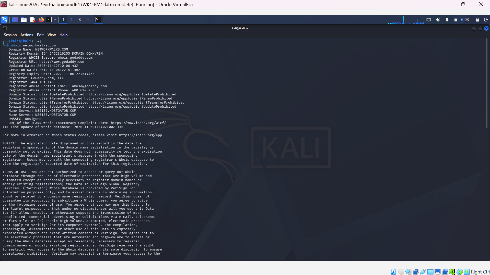

**Findings:**

| Field | Value |
|---|---|
| Registrar | GoDaddy.com, LLC |
| Creation Date | 2019-11-06 |
| Registry Expiry Date | 2027-11-06 |
| Name Servers | NS6135.HOSTGATOR.COM, NS6136.HOSTGATOR.COM |

**Analysis:** The name servers immediately reveal that the site is hosted on **HostGator**. This is free reconnaissance: it tells an attacker which hosting provider to target or impersonate (for example, in a social-engineering attempt against HostGator support) without ever contacting networkwalks.com's own server.

### 4.2 whatweb — Technology Fingerprinting

```
$ whatweb networkwalks.com
```

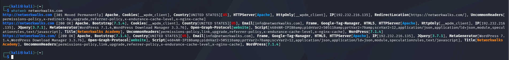

**Findings:**

| Field | Value |
|---|---|
| Web Server | Apache |
| CMS | WordPress 7.1.4 |
| Plugin | WordPress Download Manager 3.3.76 |
| Server IP | 192.232.216.135 |

**Analysis:** Knowing "it's WordPress" is only a category. Knowing the **exact version** of WordPress and the Download Manager plugin turns this into a direct lookup key into public vulnerability databases such as CVE lists and Exploit-DB. An attacker would search these exact version strings to check for known exploits. This is why exposed version banners are treated as a real finding, not trivia.

### 4.3 nslookup — DNS Resolution

```
$ nslookup networkwalks.com
```

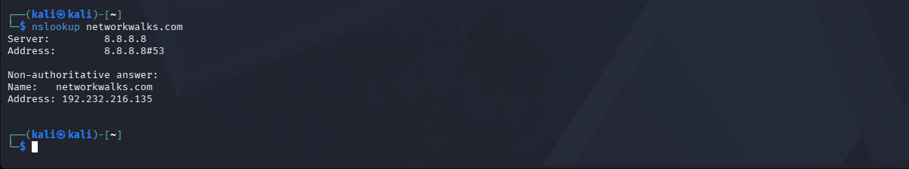

**Findings:** Resolved IP: **192.232.216.135** — matches the IP already seen in the whatweb output.

**Analysis:** This confirms the domain is not hidden behind a reverse proxy or CDN (such as Cloudflare), where DNS would otherwise resolve to the proxy's IP rather than the real server. Since both tools returned the same address, the server observed is very likely the actual origin server.

### 4.4 curl -I — HTTP Response Headers

```
$ curl -I https://networkwalks.com
```

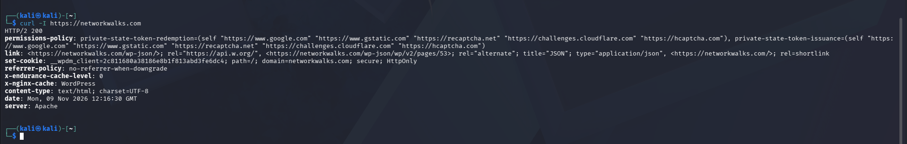

**Key headers found:**

```
link: <https://networkwalks.com/wp-json/>; rel="https://api.w.org/"
set-cookie: __wpdm_client=...; path=/; domain=networkwalks.com; secure; HttpOnly
server: Apache
```

**Analysis:** The `link` header exposes a hidden WordPress REST API endpoint (`/wp-json/`) that whatweb's summary did not call out directly. This is an example of raw headers revealing supporting detail (specific doors into the application) beyond a tool's category-level summary. On the positive side, the session cookie is correctly flagged `secure` and `HttpOnly`, which is good security practice.

### 4.5 wafw00f — Web Application Firewall Detection

```
$ wafw00f networkwalks.com
```

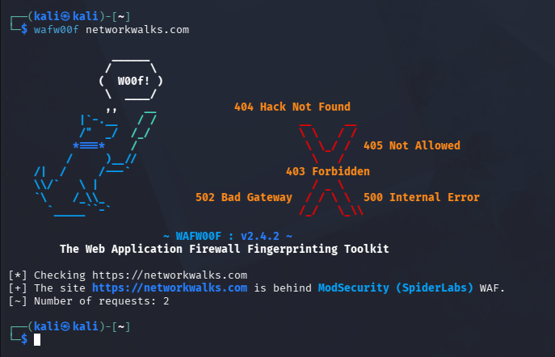

**Finding:** The site is behind **ModSecurity (SpiderLabs) WAF**.

**Analysis:** A confirmed WAF changes how every other finding in this report should be read. Everything observed so far is "what the server is willing to show through a protective layer," not necessarily the full, unfiltered truth about the backend. For an attacker, naive attack attempts will likely be blocked or logged by ModSecurity, forcing them to adapt their approach.

### 4.6 dnsrecon — DNS Enumeration

```
$ dnsrecon -d networkwalks.com
```

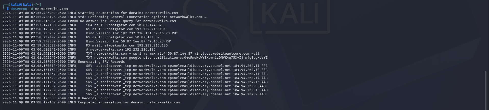

**Key records found:**

| Record type | Value |
|---|---|
| SOA / NS | ns6135.hostgator.com, ns6136.hostgator.com (confirms HostGator) |
| Bind Version | 9.16.23-RH |
| MX | mail.networkwalks.com → 192.232.216.135 |
| TXT (SPF) | `v=spf1 +a +mx +ip4:50.87.144.87 +include:websitewelcome.com ~all` |
| SRV | 8 cPanel autodiscover records (cpanelemaildiscovery.cpanel.net) |

**Analysis:** The SPF record lists which mail servers are authorized to send email on behalf of the domain, so receiving servers can reject forged messages claiming to be from networkwalks.com. The `include:websitewelcome.com` entry ties back to HostGator's own infrastructure brand (WebsiteWelcome), corroborating the hosting provider identified in Section 4.1 through a completely independent tool. The SRV records confirm the hosting control panel in use is **cPanel**.

---

## 5. Module 2 — Footprinting with theHarvester (W2-PM4)

**Target:** microsoft.com (as specified by the module; used for tool demonstration purposes)

### 5.1 Task 1 — Baidu Search, Limit 1000

```
$ theHarvester -d microsoft.com -l 1000 -b baidu
```

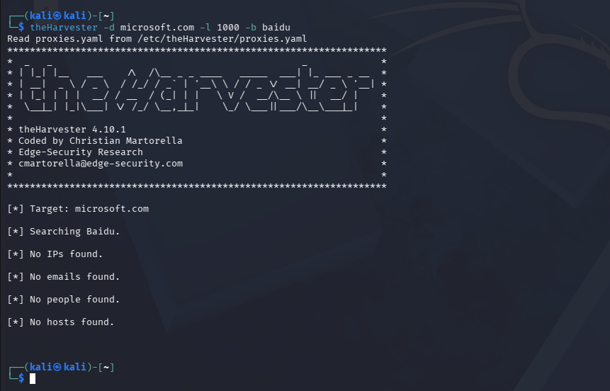

**Result:** No emails, people, or hosts found via Baidu for this domain.

**Analysis:** theHarvester depends entirely on third-party sources, and results vary as those sources change their indexing and scraping policies over time. A single source returning nothing is a valid, expected outcome, not a tool failure; it highlights why using multiple sources (as in Task 2) is important for thorough reconnaissance.

### 5.2 Task 2 — All Sources, Limit 50

```
$ theHarvester -d microsoft.com -l 50 -b all
```

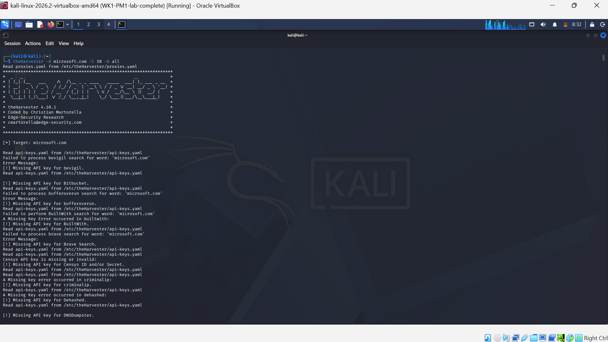

**Result:** A large number of sub-domains were discovered, for example:

```
yahoo.ads.microsoft.com
yakko.buddy.microsoft.com:131.107.86.17
zeus.buddy.microsoft.com:131.107.86.4
z11.onelake.fabric-df.microsoft.com
z55.datawarehouse.fabric.microsoft.com
```

**Analysis:** Each discovered sub-domain is a potential door into the organization that defenders may have forgotten about. Notably, two sub-domains (`yakko.buddy` and `zeus.buddy`) were returned with internal-facing IP addresses directly attached, which is a more specific finding than a bare hostname. A large sub-domain footprint like this expands the overall attack surface significantly, which is why defenders are encouraged to run the same passive tools against their own domains to discover what they are inadvertently exposing.

---

## 6. Module 3 — Network Scanning with Zenmap (W2-PM5)

**Target:** My own local area network (authorized — owned and controlled by me)

### 6.1 Finding the Local Subnet

```
C:\> ipconfig
```

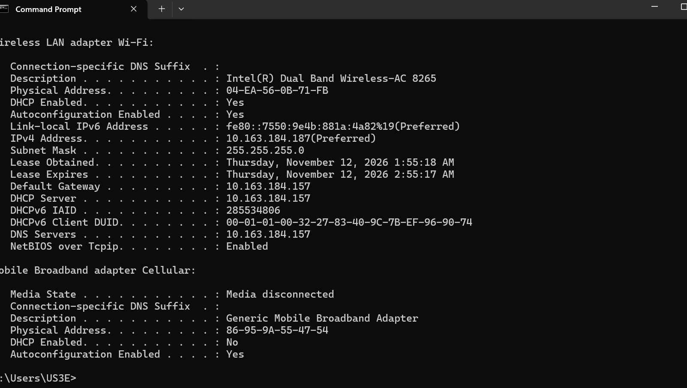

| Field | Value |
|---|---|
| IPv4 Address | 10.163.184.187 |
| Subnet Mask | 255.255.255.0 |
| Default Gateway | 10.163.184.157 |
| Subnet (CIDR) | 10.163.184.0/24 |

My machine has two adapters with an IPv4 address: a VirtualBox host-only adapter (192.168.56.1, no gateway) and my real Wi-Fi adapter (10.163.184.187, with a gateway). The Wi-Fi adapter was used as the scan target, since the presence of a default gateway confirms it is the adapter actually connected to my router.

### 6.2 Ping Scan of the Subnet

```
nmap -sn 10.163.184.0/24
```

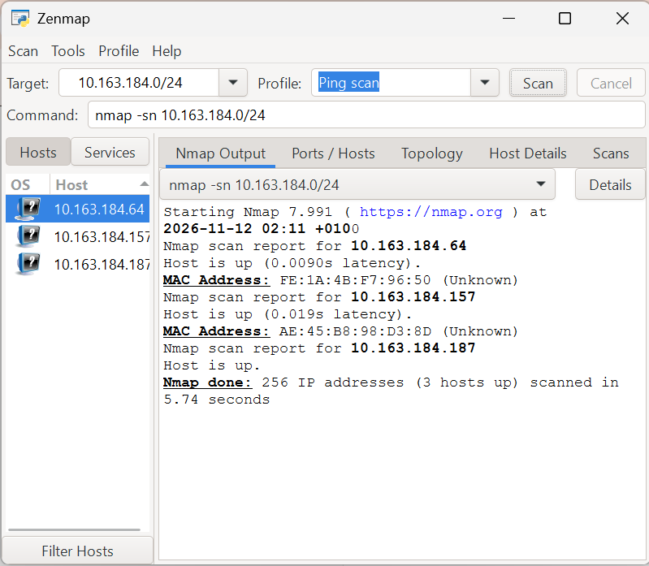

**Result:** `Nmap done: 256 IP addresses (3 hosts up) scanned in 5.74 seconds`

| IP Address | MAC Address | Identity |
|---|---|---|
| 10.163.184.157 | AE:45:B8:98:D3:8D | Router (default gateway) |
| 10.163.184.187 | 04-EA-56-0B-71-FB *(from `ipconfig /all`)* | My laptop |
| 10.163.184.64 | FE:1A:4B:F7:96:50 | Another device that joined the network during testing |

**Note:** An initial scan found 2 hosts up; a later re-scan found 3, after a new device joined the Wi-Fi network. This reflects a real, expected characteristic of live networks — host counts can change between scans as devices connect and disconnect — and the most recent scan was used for this report.

**Analysis:** A ping scan is the least intrusive form of network reconnaissance: it identifies which hosts are alive without probing any of their ports or services. This is typically the first step before any further authorized scanning.

### 6.3 Network Topology

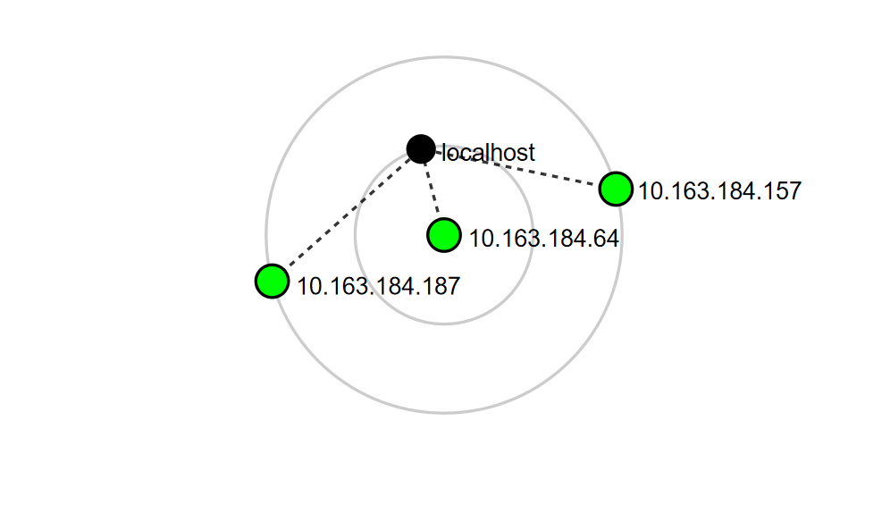

A visual topology diagram was generated and saved showing the three discovered hosts and the local scanning machine.

---

## 7. Troubleshooting Encountered

During Module 2 (theHarvester), I initially mistyped the target domain as `miscrosoft.com` instead of `microsoft.com`. This produced a single, garbled result (`u003e@miscrosoft.com`), which turned out to be an unrelated domain rather than a real finding. After re-reading the command carefully and correcting the spelling, I re-ran the tool against the correct domain and received a clean, expected "No emails found" result. This reinforced the importance of double-checking target input character by character in reconnaissance tools, since a small typo can silently redirect an entire scan toward the wrong target.

## 8. Summary and Key Takeaways

- **Passive reconnaissance is powerful precisely because it is invisible** — every tool in Modules 1 and 2 only read information the targets had already made public, without the targets ever knowing they were being studied.
- **Findings compound across tools.** The HostGator hosting provider was independently confirmed through whois (Section 4.1) and again through the SPF record's `websitewelcome.com` reference (Section 4.6) — cross-checking findings this way builds confidence in a conclusion.
- **A confirmed WAF (ModSecurity) reframes every other finding** as "what is visible through a protective layer" rather than unfiltered ground truth.
- **Exact version numbers matter far more than tool/software categories** — they are the actual lookup key into vulnerability databases.
- **Network host counts are not static** — a ping scan is a snapshot in time, and re-scanning the same subnet can legitimately return different results.
- All testing in this report stayed strictly within the scope defined in the accompanying Letter of Authorization.

---

*Completed as part of the Networkwalks Cybersecurity Internship (Batch B084), Week 2.*
